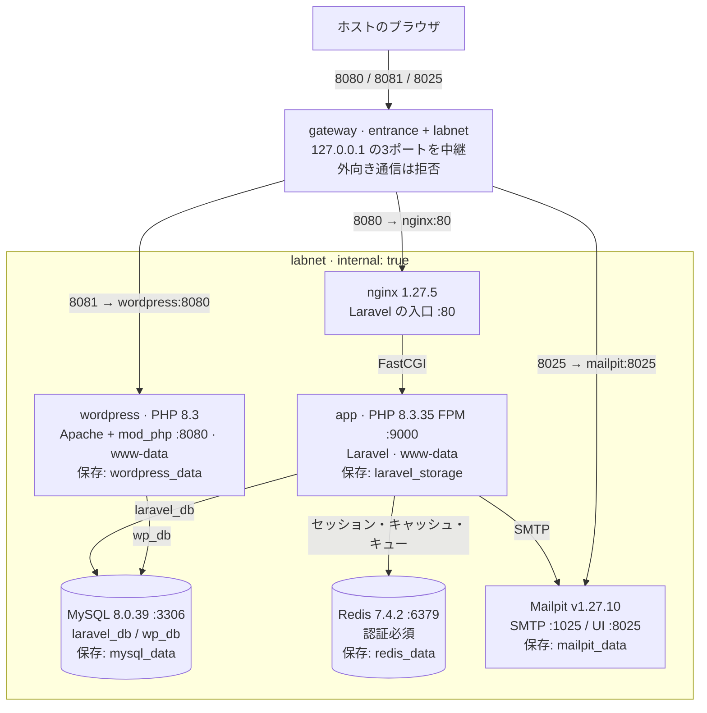
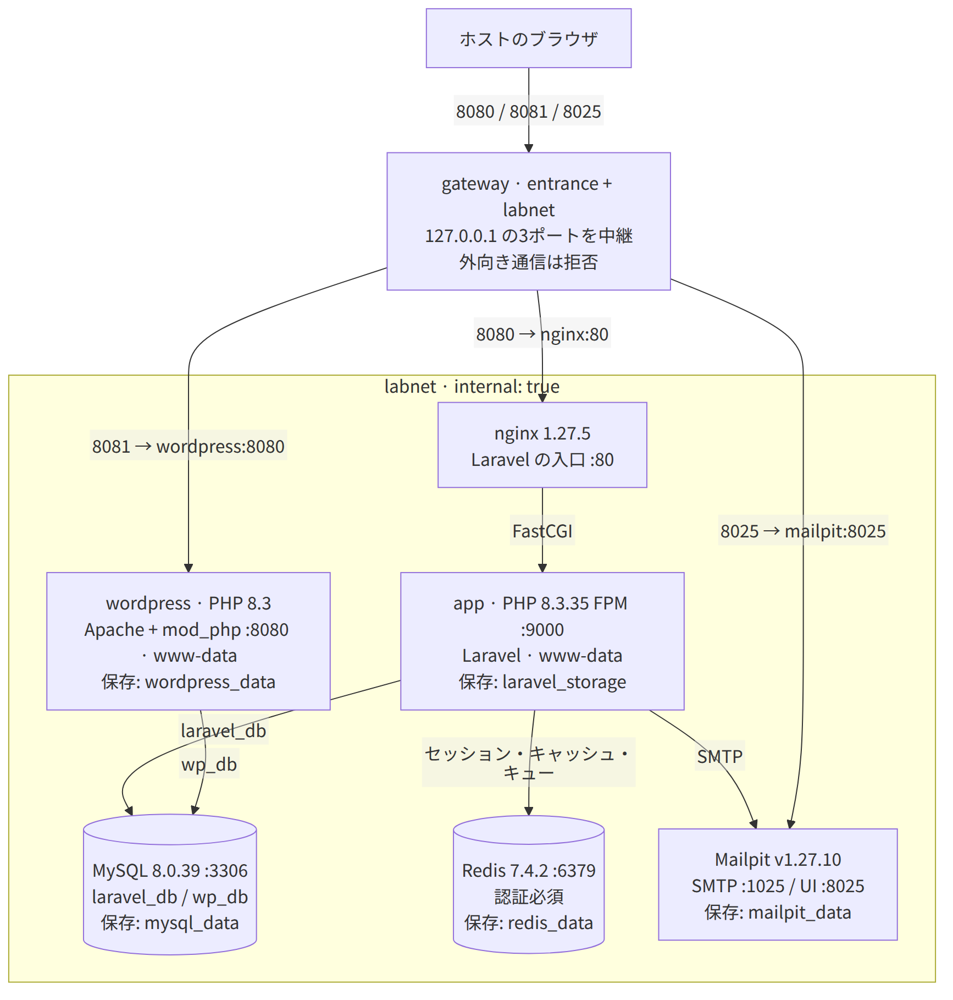

# PHP Isolated Lab



<details>
<summary>Mermaid が読み込めない場合は、同じ構成図を画像で表示</summary>



</details>

PHP 8.3.35 の Laravel と、公式 WordPress の PHP 8.3 / Apache を、端末内だけで検証する環境です。
指定された古い版を再現するためのものです。本番用の資格情報は入れないでください。

## 起動する

Linux の Docker Engine と Docker Compose v2.20 以降を用意し、8080・8081・8025 が空いていることを確認します。
動作確認には Docker Engine 29.4.1 / Compose 5.1.3 を使っています。Docker Desktop は未確認です。
ホストへの PHP・Composer・MySQL の導入や、`.env` のコピーは不要です。

```bash
git clone https://github.com/kkm-horikawa/php-isolated-lab.git
cd php-isolated-lab
docker compose up -d
```

初回はイメージ取得・OS パッケージ取得・Composer の依存導入のため、**ホストのビルド工程にインターネット接続が必要**です。
Laravel は公式の初期アプリを同梱し、依存の版を `composer.lock` で固定してビルドします。
アプリ起動時に `composer create-project` やパッケージ取得は実行しません。

```bash
# 全サービスの準備完了を待つ場合
docker compose up -d --wait --wait-timeout 180
docker compose ps
```

検証者は次の順にブラウザで確認します。

| 開く場所 | 表示されるもの |
| --- | --- |
| <http://127.0.0.1:8080> | Laravel の初期ページ「Let's get started」 |
| <http://127.0.0.1:8081> | DB 接続済み WordPress の初期セットアップ画面 |
| <http://127.0.0.1:8025> | Mailpit の受信一覧 |

WordPress は言語選択・サイト設定の画面まで用意しています。管理者の作成は検証者が必要に応じて行います。
DB の接続先は `wp_db` として設定済みです。追加の言語の取得や更新は、隔離しているため実行できません。

## 配置

```text
.
├── docker-compose.yml          # 6サービス + 入口専用の中継、ネットワーク、保存先
├── .env                        # MySQL root と WordPress 用の公開サンプル
├── applications/
│   └── laravel/                # 公式 Laravel 初期アプリと composer.lock
│       └── .env                # APP_KEY、DB・Redis・SMTP・AWS の公開サンプル
├── docker/
│   ├── app/                    # PHP 8.3.35、クライアント、FPM 設定
│   ├── wordpress/              # 公式イメージを www-data で起動する設定
│   ├── gateway/                # 127.0.0.1 の入口、外向き通信拒否、権限の破棄
│   ├── nginx/default.conf      # Laravel public への転送
│   ├── mysql/init/001-lab.sql   # 2DB、専用ユーザー、users とサンプル3件
│   └── redis/redis.conf        # requirepass と AOF 保存
├── docs/architecture.png       # 冒頭の Mermaid から描画した画像版
├── scripts/check.sh            # 起動からメール受信・隔離までの確認
└── tests/                      # Laravel とホストからの疎通確認
```

## www-data で検証する

```bash
docker compose exec --user www-data app bash
docker compose exec --user www-data wordpress bash
```

両方に `/bin/bash` をログインシェルとする `www-data` が存在します。
FPM は親・子ともに www-data、Apache も親・子ともに www-data で動きます。
Apache はコンテナ内の 8080 で待ち受け、ホストの 127.0.0.1:8081 に転送します。
Laravel のコードはイメージ内にあり、www-data は `storage` と `bootstrap/cache` に書き込めます。

app のシェルから、環境変数を使って DB・Redis・SMTP に接続できます。

```bash
id
php -v
mysql --skip-ssl -h "$DB_HOST" -u "$DB_USERNAME" --password="$DB_PASSWORD" \
  "$DB_DATABASE" -e 'SELECT id, name, email FROM users;'
REDISCLI_AUTH="$REDIS_PASSWORD" redis-cli -h "$REDIS_HOST" ping
php -r '$s = fsockopen("mailpit", 1025); echo fgets($s); fclose($s);'
```

SQL はサンプル3件、Redis は `PONG`、SMTP は `220` で始まる応答を返します。
MySQL クライアントは Debian の `default-mysql-client`（MariaDB 互換クライアント）です。
このローカル環境では `--skip-ssl` を使います。

## Laravel からメールを送り、画面で読む

```bash
docker compose exec --user www-data app php artisan tinker --execute='\Illuminate\Support\Facades\Mail::raw("Hello from the isolated lab", function ($message) { $message->to("reviewer@example.test")->subject("PHP lab test"); });'
```

Mailpit の <http://127.0.0.1:8025> に戻ると「PHP lab test」が表示されます。
メールを開いて本文を確認できます。外部のメールサーバーへは転送しません。
SMTP の架空のユーザー名・パスワードは Laravel の `.env` に含めています。
Mailpit は検証用に任意の SMTP 認証を受け入れ、TLS なしで動作します。

Redis のキューには投入・取得ができます。指定の6サービスに常駐ワーカーは含めていません。
ジョブを実行する場合は app のシェルで `php artisan queue:work --once` を実行します。

## 自動で確かめる

任意の検査用に、ホストの Bash と Python 3 を使います。

```bash
./scripts/check.sh
```

6サービスと中継の準備完了を待ち、次を実際に確認します。メールを1通だけ追加します。

- 両アプリへの www-data の Bash アクセスと PHP の版。
- app からサービス名での名前解決と MySQL 接続、サンプル3件とパスワードハッシュ。
- DB ユーザーの分離、Redis の未認証拒否、Laravel の認証接続。
- Laravel の Redis キャッシュ、セッション保存・再読込み、キュー投入・取得。
- Laravel の SMTP 送信と Mailpit の受信記録。
- Laravel / WordPress / Mailpit の HTTP 応答。
- アプリなどの6サービスが internal なネットワーク1つだけに接続し、中継の公開ポートが3つとも 127.0.0.1 に限定されること。
- 中継が外向き通信を拒否し、nginx の親・子にネットワーク設定を変える権限が残っていないこと。
- app・wordpress・中継から外部 IP および外部ドメインへの HTTPS 接続が失敗すること。

途中で失敗すると終了状態が0以外になります。データの削除や初期化は行いません。

再起動とコンテナ再作成を通したデータ保持の確認も実行できます。
検証用の印を DB・Redis・ファイルに作り、両方の操作の後で残っていることを確認して、その印だけ片付けます。
Mailpit は既存メールの識別子を照合します。作業中のシェルなどは切断されます。

```bash
python3 scripts/check-persistence.py
```

## 停止・再開とデータ保持

```bash
# 一時停止して再開する
docker compose stop
docker compose up -d

# コンテナを外して再作成する。名前付きの保存領域は残る
docker compose down
docker compose up -d
```

MySQL、Redis、WordPress、Laravel storage、Mailpit は名前付きの保存領域（named volume）を使います。
Redis は AOF（書き込みを記録して再起動時に戻す仕組み）を有効にしています。
初期化 SQL は MySQL の保存領域が空の初回にだけ実行し、再起動で users を重複投入しません。
`docker compose down --volumes` は全データを失うため、通常の停止には使いません。

SQL が users の作成を担当します。Laravel の標準マイグレーションにも users 作成があるため、
この検証環境に対して `php artisan migrate` を重ねて実行しないでください。

## バージョンと隔離の範囲

| 対象 | 固定した版 |
| --- | --- |
| app | PHP 8.3.35 FPM / bookworm |
| Laravel | 初期アプリ v12.10.0、フレームワーク 12.70.1（composer.lock） |
| WordPress | 6.8.3 / PHP 8.3.28 / Apache |
| db | MySQL 8.0.39 |
| redis | 7.4.2 / bookworm |
| nginx / gateway | 1.27.5 / bookworm |
| mailpit | v1.27.10 |
| ビルド用 Composer | 2.8.12 |
| PHP Redis 拡張 | 6.2.0 |

すべてのベースイメージをタグに加えて SHA-256 ダイジェストで固定し、取得した内容をコメントと設定に残しています。
ローカルで作る3イメージにも版付きのタグを付け、`latest` は使いません。
PHP の 8.3.35 公式タグが取得できるため、ソースからの再ビルドは不要です。
OS パッケージの配布先までは固定していないので、将来の再ビルドがバイト単位で同一になる保証はありません。
確認した実行環境は Linux x86_64 です。他の CPU での実行は未確認です。

起動後の6サービスはすべて `internal: true` の labnet のみに接続し、外部向けの接続経路を持ちません。

**仕様からの承認済みの調整:** Docker は internal ネットワークだけのコンテナへのポート公開を適用しないため、
ブラウザの入口専用に `gateway` を1つ追加しています。
[Docker の実装](https://github.com/moby/moby/blob/fbf3ed25f893e6ce21336f1101590e40a13934f4/daemon/network.go)にも internal を除外する処理があります。
6サービス自体は隔離を維持し、ホストの3ポートだけを中継が受けます。

中継は labnet と入口用の entrance に接続します。中継自身もコンテナ内の通信規則で新規の外向き接続を拒否し、
nginx:80・wordpress:8080・mailpit:8025 への転送と既存接続への応答だけを許可します。
内部の名前は `extra_hosts` で解決し、外部 DNS も使いません。IPv6 は中継内で無効にしています。
起動時に規則を設定するための NET_ADMIN などの権限は、nginx を一般ユーザーで起動する前にすべて破棄します。
規則の設定に失敗したら待受けを開始しません。ホストの通信規則や Docker ソケットには触れません。

labnet は `.env` の `LAB_PREFIX` で指定した `/24` の固定サブネットを使います。
既定は `10.243.217.0/24` です。手元のネットワークと重なる場合は、起動前に `LAB_PREFIX` の先頭3組を変えてください。
中継の許可先、名前解決、3つの転送先のアドレスは同じ値から設定します。
DB・Redis・SMTP・FPM のホストポートは公開しません。
Laravel 初期画面の外部フォントも除き、nginx で外部の画像・スクリプト・フォント読込みを制限します。
WordPress の HTTP 通信・自動更新・定期処理も停止します。

`.env`、SQL、Redis 設定には公開するためのサンプルを意図的に含めています。
AWS は公式の例示形式のアクセスキーとシークレットを使い、AWS への接続処理はありません。
APP_KEY は `php artisan key:generate --force` で生成した公開用の検証鍵です。
起動のたびに鍵を生成し直さないため、再起動してもセッションなどの暗号化に使う鍵は変わりません。
DB・Redis のサンプル資格情報を変更する場合は、それぞれの `.env` と SQL / redis.conf の対応も変更する必要があります。
既存の MySQL 保存領域に初期化 SQL の編集は再適用されません。

## 起動に失敗した場合

```bash
docker compose ps
docker compose logs --tail 80 app db wordpress redis mailpit nginx
```

ホストのポートが使用中なら、使用中のアプリを停止するか別の端末で検証してください。
初回ビルドの取得に失敗した場合はホスト側の通信を確認して `docker compose up -d --build` を再実行します。
アプリのコードを編集した場合も、同じコマンドでイメージを作り直します。
